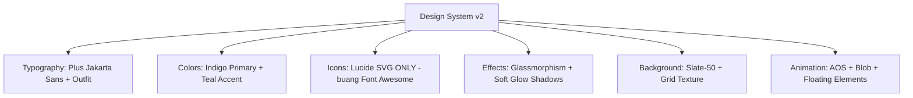

# Pelan Naik Taraf AI4STEM v2.0 — Semakan & Penambahbaikan

> **Status**: ✅ DIMUKTAMADKAN — Sedia untuk pelaksanaan
> **Tarikh**: 20 Julai 2026
> **Objektif**: Menilai semula pelan asal dan mencadangkan penambahbaikan yang lebih kemas, praktikal, dan berkualiti tinggi.

## ✅ Keputusan Reka Bentuk (Telah Dipersetujui)

| ID | Keputusan | Pilihan |
|----|-----------|---------|
| D1 | Kad Alatan | **4 kad Bento Grid** — Audio & Video kekal berasingan |
| D2 | Dropdown kosong nav | **Sembunyi** — "Explorasi AI" & "AI4STEM" dikeluarkan |
| D3 | Carousel slaid | **2 slaid** — lebih fokus, imej tempatan |
| D4 | Pengganti guestbook | **CTA "Sertai Komuniti"** — ringkas & elegan |
| D5 | Gaya reka bentuk | **Sophisticated Light + Glassmorphism** |

---

## 📋 Ringkasan Isu Pelan Asal

| # | Isu | Keterangan |
|---|-----|------------|
| 1 | **Gabung Audio+Video → 3 kad** | Grid 4-kad sedia ada seimbang (2×2). 3 kad akan tinggalkan ruang kosong janggal atau memerlukan reka bentuk semula besar. |
| 2 | **Dark mode penuh** | Untuk audiens pendidik Malaysia, dark mode mungkin kurang sesuai. Cadangan: *Sophisticated Light* dengan glassmorphism premium. |
| 3 | **Ikon tidak konsisten** | `index.html` guna Lucide, tapi `nav-component.js` guna **Font Awesome** (`fas fa-*`). `audio_ai.html` tidak masukkan Font Awesome — ikon nav akan pecah. |
| 4 | **Dropdown kosong** | "Explorasi AI" & "AI4STEM" dalam nav hanya tunjuk "Akan Datang" — nampak tidak profesional. |
| 5 | **Tiada pengganti guestbook** | Buang guestbook tinggalkan ruang kosong besar di bahagian bawah halaman. |
| 6 | **Carousel guna imej Unsplash** | Pautan luaran boleh putus bila-bila masa. |
| 7 | **Footer tiada pautan sebenar** | Butang sosial semua kosong (tiada `href`). |
| 8 | **Tiada lazy loading** | Semua imej dimuatkan serentak — beban halaman tinggi. |
| 9 | **Tiada meta/SEO** | Sub-halaman tiada `meta description` yang betul. |

---

## 🎨 1. Sistem Reka Bentuk (Design System)

### Cadangan: *Sophisticated Light* + Glassmorphism
Bukan dark mode penuh, tetapi **light mode premium** dengan:

- **Latar**: `bg-slate-50` sedia ada dikekalkan, tapi ditambah tekstur grid halus (`bg-grid-slate` sedia ada dalam CSS)
- **Kad**: Kesan *frosted glass* — `backdrop-blur-md`, `bg-white/80`, sempadan `border-white/20`
- **Palet Warna**: Kekalkan Indigo (`#4f46e5`) sebagai warna utama. Tambah aksen **Cyan/Teal** (`#14b8a6`) untuk kontras.
- **Tipografi**: Kekal — Plus Jakarta Sans (body) + Outfit (display). Font ini sudah premium dan moden.
- **Ikon**: **Tukar SEMUA ke Lucide** (SVG). Buang Font Awesome sepenuhnya untuk konsistensi. Nav component perlu *rewrite* kepada Lucide.
- **Bayang-bayang**: Guna `shadow-xl` dengan warna indigo lembut (`shadow-indigo-500/10`) untuk efek *glow* premium.
- **Animasi**: Kekal AOS + animasi blob CSS sedia ada. Tambah animasi *floating* halus untuk elemen utama.



---

## 🏠 2. Halaman Utama ([`index.html`](index.html))

### 2.1 Hero Section — Bina Semula (Separuh)

**Kekalkan:**
- Typewriter effect dengan frasa STEM+AI
- Blob animasi latar (3 blobs bergerak)
- Badge "Pendidikan STEM & AI" di atas

**Tambah Baik:**
- **Particle/Grid Network** di belakang blob sebagai lapisan tambahan (gunakan CSS `radial-gradient` atau kanvas kecil)
- **4 Metrik Utama** dialihkan ke dalam hero section (bawah butang CTA), dengan animasi *count-up* nombor:
  - 500+ Pendidik Dilatih
  - 20+ Modul AI
  - 100% Akses Percuma
  - 24/7 Sokongan
- Gradien teks yang lebih dinamik (`from-brand-600 via-purple-500 to-accent-500`)

### 2.2 Video Section — Kekal dengan Penambahbaikan
- Kekalkan YouTube embed
- Tambah `loading="lazy"` pada iframe
- **Keluarkan statistik** (dah pindah ke hero)
- Ganti dengan **testimoni pendek** atau petikan inspirasi (1-2 baris)

### 2.3 STEM Features (Teras STEM) — Kekal, Kemas Kini
- 4 kad sedia ada dikekalkan
- Tambah **ikon Lucide** ganti Font Awesome (flask → `flask-conical`, cpu → `cpu`, wrench → `wrench`, binary → `binary`)
- Tambah *hover state* lebih premium: `hover:scale-[1.02]` + glow shadow
- Setiap kad dapat "nombor" kecil di penjuru (01–04) untuk rasa *curated*

### 2.4 Modul Carousel — Bina Semula
**Isu utama**: Imej dari Unsplash (pautan luaran).

**Cadangan**: 
- Ganti dengan **imej tempatan** dari `assets/img/` (cth: `ai_junior_hero.png`, `game_hero.png`, `mindmap_hero_v2.png`)
- Atau kekal Unsplash tapi tambah `loading="lazy"` + *fallback* warna latar jika imej gagal
- Kurangkan kepada **2 slaid** sahaja (lebih fokus, kurang gangguan)
- Tambah *progress dots* di bawah sebagai indikator slaid

### 2.5 Kotak Peralatan Digital — Reka Semula Bento Grid (4 Kad)

✅ **KEPUTUSAN D1-A**: Kekal 4 kad dengan reka bentuk Bento Grid premium.

```
┌─────────────────────┬─────────────────────┐
│                     │                     │
│   ⬡ AI Teks        │   🖼️ AI Visual      │
│   (Featured, besar) │                     │
│                     │                     │
├─────────────────────┴─────────────────────┤
│  🎤 AI Suara        │  🎬 AI Video        │
│  (tag: Multimedia)  │  (tag: Multimedia)  │
└─────────────────────┴─────────────────────┘
```

**Spesifikasi Bento Grid:**
- **Baris atas** (2 kolum): Kad AI Teks & AI Visual — lebih besar, `md:col-span-1` dalam grid 2-kolum
- **Baris bawah** (2 kolum): Kad AI Suara & AI Video — dengan label "AI Multimedia" sebagai *section divider* di antara baris
- Setiap kad: `bg-white/80 backdrop-blur-md`, ikon Lucide, deskripsi, butang "Info" + "Buka Modul"
- *Hover effect*: `hover:scale-[1.02]` + glow shadow (`shadow-indigo-500/10`)
- Warna setiap kad ikut kategori: Indigo (Teks), Teal (Visual), Orange (Audio), Pink (Video)

### 2.6 Guestbook → Ganti dengan Seksyen Baharu

| Sebelum | Selepas |
|---------|---------|
| Borang Buku Pelawat + Senarai Ucapan | **"Sertai Komuniti" CTA Section** |
| `guestbook.js` dimuatkan | Skrip dibuang |
| Navigasi "Pelawat" | Navigasi dikemas kini |

**Cadangan pengganti**: Seksyen *Call-to-Action* yang ringkas dan elegan:
- Tajuk: "Sertai Revolusi Pendidikan AI"
- Subtitle: "Bersama ribuan pendidik yang telah memulakan perjalanan STEM & AI"
- Dua butang: "Mula Belajar Percuma" (ke `#alatan`) & "Hubungi Kami" (ke emel/WhatsApp)
- Latar: gradien indigo ke teal dengan corak geometri

---

## 🧭 3. Navigasi ([`assets/js/nav-component.js`](assets/js/nav-component.js))

### 3.1 Tukar Font Awesome → Lucide Ikon
Ini perubahan paling kritikal. Kod semasa:

```javascript
// MASALAH: Guna Font Awesome (fas fa-*)
<i class="fas fa-sparkles"></i>
<i class="fas fa-chevron-down"></i>
```

Perlu ditukar kepada:
```html
<!-- PENYELESAIAN: Guna Lucide SVG -->
<i data-lucide="sparkles" class="w-4 h-4"></i>
<i data-lucide="chevron-down" class="w-4 h-4"></i>
```

Ini memastikan ikon konsisten di **semua halaman** tanpa bergantung pada Font Awesome.

### 3.2 Buang Butang "Pelawat"
- Desktop: Buang `<a href="index.html#guestbook">Pelawat</a>`
- Mobile: Buang `<a href="index.html#guestbook">Buku Pelawat</a>`
- Ganti dengan butang "Mula Belajar" yang *scroll to tools section*

### 3.3 Sembunyi Dropdown Kosong
"Explorasi AI" & "AI4STEM" hanya tunjuk "Akan Datang". Cadangan:
- **Sembunyikan** kedua-dua dropdown buat masa ini
- Atau **ganti** dengan satu dropdown "Lagi" yang mengandungi pautan berguna:
  - "Juara Lagu AI" → [`juara_lagu.html`](juara_lagu.html) (jika ada)
  - "Kajian Tindakan" → pautan ke PDF

### 3.4 Mobile Menu — Kemas Kini
- Ikon Font Awesome → Lucide
- Struktur menu selari dengan desktop
- Tutup menu automatik bila pautan diklik

---

## 🔧 4. Pembetulan & Penambahbaikan Sampingan

### 4.1 Imej Lazy Loading
Semua `` perlu ada `loading="lazy"`:
```html

```

### 4.2 Footer — Pautan Sosial Sebenar
Ganti butang sosial kosong:
```html
<!-- sebelum -->
<button class="p-2 text-slate-400">...</button>

<!-- selepas -->
<a href="https://youtube.com/@..." target="_blank" rel="noopener" class="p-2 text-slate-400 hover:text-brand-600">...</a>
```

### 4.3 Meta Tags SEO
Setiap halaman perlu ada `meta description` yang unik:
```html
<meta name="description" content="AI4STEM - Hub Integrasi STEM & AI untuk pendidik Malaysia. Kuasai AI generatif, visual, audio, dan video untuk bilik darjah.">
```

### 4.4 Back-to-Top Button
Butang kecil di penjuru kanan bawah yang muncul selepas *scroll*:
```html
<button onclick="window.scrollTo({top:0,behavior:'smooth'})" 
  class="fixed bottom-6 right-6 w-12 h-12 bg-brand-600 text-white rounded-full shadow-lg 
         opacity-0 translate-y-4 transition-all duration-300 z-50"
  id="back-to-top">
  <i data-lucide="arrow-up" class="w-5 h-5 mx-auto"></i>
</button>
```

### 4.5 Carousel — Ganti Imej Unsplash
| Slaid | Imej Semasa | Imej Cadangan |
|-------|-------------|---------------|
| 1 | `images.unsplash.com/photo-1531482615713` | `assets/img/ai_junior_hero.png` |
| 2 | `images.unsplash.com/photo-1526374965328` | `assets/img/game_hero.png` |
| 3 | `images.unsplash.com/photo-1611162617474` | `assets/img/mindmap_hero_v2.png` |

---

## 📁 5. Fail Yang Terlibat

| Fail | Tindakan | Keterangan |
|------|----------|------------|
| [`index.html`](index.html) | ✏️ Ubah suai besar | Hero, kad alatan, guestbook, carousel, footer |
| [`assets/js/nav-component.js`](assets/js/nav-component.js) | ✏️ Tulis semula | Font Awesome → Lucide, buang Pelawat, sembunyi dropdown kosong |
| [`assets/js/main.js`](assets/js/main.js) | ✏️ Kemas kini | Tambah back-to-top logic, count-up animation |
| [`assets/css/style.css`](assets/css/style.css) | ✏️ Tambah | Glassmorphism, bento grid, glow shadows, particle bg |
| [`assets/js/guestbook.js`](assets/js/guestbook.js) | ❌ Buang / arkib | Tidak digunakan lagi |
| [`generatif_ai.html`](generatif_ai.html) | 🔍 Semak | Pastikan ikon Lucide sahaja (tiada Font Awesome) |
| [`visual_ai.html`](visual_ai.html) | 🔍 Semak | Buang Font Awesome, guna Lucide |
| [`audio_ai.html`](audio_ai.html) | 🔍 Semak | Tiada Font Awesome — OK, tapi pastikan Lucide |
| [`video_ai.html`](video_ai.html) | 🔍 Semak | Buang Font Awesome, guna Lucide |
| [`IMPROVEMENTS.md`](IMPROVEMENTS.md) | ✏️ Kemas kini | Tandakan item yang telah selesai |

---

## 🗂️ 6. Senarai Semak Pelaksanaan (Execution Checklist)

### Fasa 1: Pembetulan Infrastruktur
- [ ] 1.1 Tukar `nav-component.js` dari Font Awesome → Lucide SVG
- [ ] 1.2 Buang butang "Pelawat" dari nav (desktop + mobile)
- [ ] 1.3 Sembunyikan dropdown kosong "Explorasi AI" & "AI4STEM"
- [ ] 1.4 Tutup mobile menu automatik bila pautan diklik

### Fasa 2: Halaman Utama — [`index.html`](index.html)
- [ ] 2.1 Hero: Tambah particle/grid network latar, pindah metrik ke hero dengan count-up
- [ ] 2.2 Hero: Upgraded gradient text + refined typewriter phrases
- [ ] 2.3 Video: Keluarkan statistik (dah di hero), tambah petikan/testimoni
- [ ] 2.4 STEM Features: Kemas kini hover states + nombor penjuru
- [ ] 2.5 Carousel: Ganti imej Unsplash → tempatan, kurangkan 2 slaid, tambah progress dots
- [ ] 2.6 Alatan: Reka semula ke Bento Grid 4 kad (✅ Opsyen A dipilih)
- [ ] 2.7 Guestbook: **Buang sepenuhnya** (form + senarai + skrip)
- [ ] 2.8 Ganti guestbook dengan "Sertai Komuniti" CTA section
- [ ] 2.9 Footer: Tambah pautan sosial sebenar
- [ ] 2.10 Tambah Back-to-Top button

### Fasa 3: Sub-Halaman
- [ ] 3.1 Buang Font Awesome dari `visual_ai.html`, `video_ai.html`, `generatif_ai.html`
- [ ] 3.2 Pastikan semua ikon guna Lucide (`data-lucide`)
- [ ] 3.3 Tambah `meta description` pada setiap halaman

### Fasa 4: CSS & JS Global
- [ ] 4.1 `style.css`: Tambah glassmorphism, bento grid, glow shadow, particle bg classes
- [ ] 4.2 `main.js`: Tambah back-to-top logic, count-up animation, mobile menu close
- [ ] 4.3 Buang `guestbook.js` rujukan dari `index.html`

### Fasa 5: Pengujian
- [ ] 5.1 Uji responsif: Mobile (375px), Tablet (768px), Desktop (1280px+)
- [ ] 5.2 Uji semua pautan navigasi berfungsi
- [ ] 5.3 Uji typewriter effect masih berjalan
- [ ] 5.4 Uji carousel berfungsi dengan imej tempatan
- [ ] 5.5 Uji back-to-top button muncul dan berfungsi
- [ ] 5.6 Uji semua ikon Lucide dipaparkan dengan betul

---

## ✅ 7. Keputusan — Semua Telah Dipersetujui

| # | Keputusan | Pilihan | Rasional |
|---|-----------|---------|----------|
| D1 | Kad Alatan | **4 kad Bento** | Grid seimbang, setiap modul jelas |
| D2 | Dropdown kosong | **Sembunyi** | Elak nampak tidak siap |
| D3 | Carousel slaid | **2 slaid** | Lebih fokus, imej tempatan |
| D4 | Pengganti guestbook | **CTA Section** | Kekal *call-to-action* di bawah |
| D5 | Gaya reka bentuk | **Sophisticated Light** | Sesuai audiens pendidik |

---

> ✅ Pelan ini telah dimuktamadkan dan sedia untuk dilaksanakan dalam **💻 Code mode**.
